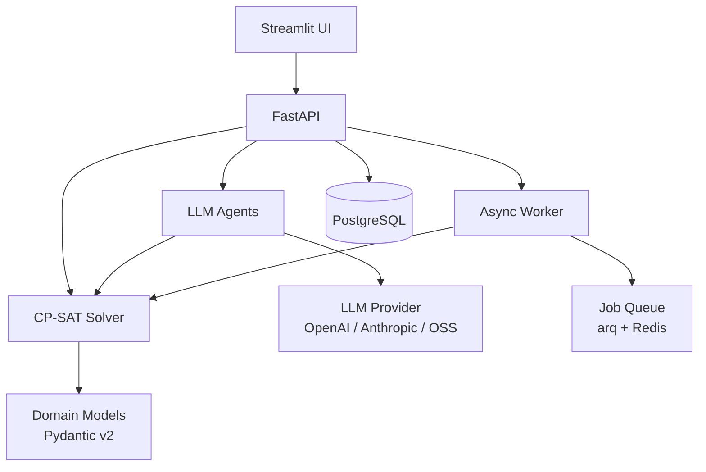

# PlanPilot

> An LLM copilot on top of a constraint-programming production scheduler

PlanPilot combines **OR-Tools CP-SAT** constraint programming with **Large Language Models** to build a production-grade Advanced Production Scheduling (APS) system. It translates natural-language scheduling rules into validated solver constraints, provides grounded explainability for scheduling decisions, onboards messy ERP data, and compares scheduling scenarios with AI-generated insights.

## Features

| Feature | Description |
|---------|-------------|
| **NL → Constraints** | Natural-language scheduling rules validated and compiled to CP-SAT constraints |
| **Grounded Explainability** | "Why is this order late?" answered with cited solver facts, not LLM guesses |
| **Agentic ERP Onboarding** | Read messy SAP-style extracts, map to data model, flag errors before go-live |
| **Scenario Comparison** | Compare two schedules on KPIs with AI-generated recommendations |
| **Flexible Job-Shop Solver** | CP-SAT with alternative machines, sequence-dependent setups, downtimes |

## Architecture



## Quick Start

```bash
# Clone
git clone https://github.com/okBhavya/PlanPilot.git
cd PlanPilot

# Setup
cp .env.example .env  # configure API keys
uv venv .venv && source .venv/bin/activate  # or .venv\Scripts\activate on Windows
uv pip install -e ".[dev]"

# Test
make test

# Run (Docker)
make up
```

## Results

TBD (run `make eval`)

## Design Decisions

See [docs/INTERVIEW_NOTES.md](docs/INTERVIEW_NOTES.md) and [docs/ARCHITECTURE.md](docs/ARCHITECTURE.md).

## License

MIT
