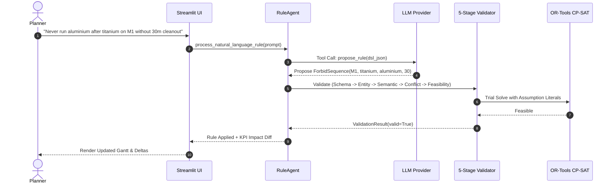
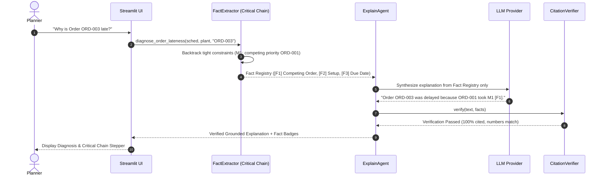

# PlanPilot System Architecture

## 1. Executive Summary

**PlanPilot** is an AI-native Advanced Production Scheduling (APS) copilot. It integrates Large Language Models (LLMs) with Google OR-Tools Constraint Programming (CP-SAT) to deliver natural-language rule authoring, deterministic explainability, agentic ERP onboarding, and multi-criteria scenario comparison.

The core architectural invariant is that **the LLM never decides scheduling facts**. The constraint solver, deterministic validators, and backward critical-chain tracers serve as the immutable source of mathematical truth; the LLM functions exclusively as a semantic translator and language synthesizer grounded on verifiable facts.

---

## 2. System Architecture Diagram

```mermaid
graph TD
    subgraph Client Layer
        UI[Streamlit Operator Workspace :8501]
        CLI[Typer CLI / CI Runner]
        REST_Client[ERP / MES Webhook]
    end

    subgraph API Gateway & Persistence
        API[FastAPI Gateway :8000]
        Auth[API Key Auth + 20MB Guard]
        DB[(PostgreSQL 16 Snapshots)]
        Queue[Arq Redis JobQueue :6379]
    end

    subgraph Core AI & Orchestration
        RuleAgent[Natural Language Rule Agent]
        ExplainAgent[Grounded Explain Agent]
        ScenarioAgent[MAUT Scenario Agent]
        OnboardingAgent[Agentic ERP Onboarding]
        LLM[LLM Provider Abstraction<br/>OpenAI / Anthropic / Local Llama]
        Cache[SHA256 Response Cache]
    end

    subgraph Deterministic Engines & Solver
        Validator[5-Stage Rule Validator]
        Compilers[CP-SAT Constraint Compilers]
        Solver[OR-Tools CP-SAT Solver]
        DuckDBEngine[DuckDB In-Memory SQL Profiler]
        Tracer[Backward Critical-Chain Tracer]
        Verifier[Deterministic Citation Verifier]
    end

    UI --> API
    CLI --> Core AI & Orchestration
    REST_Client --> API
    API --> Auth
    Auth --> DB
    Auth --> Queue
    Queue --> Worker[Async Solve Worker]
    Worker --> Solver

    RuleAgent --> LLM
    ExplainAgent --> LLM
    ScenarioAgent --> LLM
    OnboardingAgent --> LLM
    LLM --> Cache

    RuleAgent --> Validator
    Validator --> Compilers
    Compilers --> Solver
    Solver --> Tracer
    Tracer --> Verifier
    Verifier --> ExplainAgent
    OnboardingAgent --> DuckDBEngine
```

---

## 3. Component Breakdown

### 3.1 Domain Models (`src/planpilot/domain/`)
- Implemented with **Pydantic v2** using immutable, frozen data models (`ConfigDict(frozen=True)`).
- Strict referential integrity: cross-references between `Plant`, `WorkCenter`, `Machine`, `Material`, `BOM`, `Routing`, and `Order` are validated upon instantiation via `Plant.validate_referential_integrity()`.

### 3.2 Constraint Programming Core (`src/planpilot/solver/`)
- **Flexible Job-Shop Formulation:** Interval variables per operation × eligible machine with `add_exactly_one` presence constraints.
- **Routing Precedence:** Enforced via alternative presence literals:
  $$\text{start}(op_{k+1}, m_b) \ge \text{end}(op_k, m_a) - M \cdot (2 - \text{presence}(op_k, m_a) - \text{presence}(op_{k+1}, m_b))$$
- **Sequence-Dependent Setups:** Pairwise ordering literals with cleanout intervals derived from the plant's `ChangeoverMatrix`.
- **Decision Trace:** Analyzes active intervals to identify tight (binding) constraints: `PREDECESSOR_END`, `MACHINE_PREDECESSOR_SETUP`, `DOWNTIME_BOUNDARY`, or `RELEASE_TIME`.
- **Infeasibility Analysis:** When constraints conflict, indicator assumption literals isolate the minimal unsatisfiable subset via `sufficient_assumptions_for_infeasibility()`.

### 3.3 Rule DSL & Validation Pipeline (`src/planpilot/rules/`)
- Pydantic v2 discriminated union over 9 production constraint types.
- **Five-Stage Validation Pipeline:**
  1. *Schema:* Pydantic structure check.
  2. *Entity Resolution:* Fuzzy string matching against plant IDs.
  3. *Semantic Invariants:* Horizon bounds and release dates.
  4. *Conflict & Cycles:* DFS directed cycle detection ($O(V + E)$).
  5. *Feasibility:* Trial solve with assumption literals to catch mathematical conflicts.

### 3.4 Grounded Explainability (`src/planpilot/explain/`)
- **Fact Extraction:** Transforms solver assignments and decision traces into typed, immutable fact records (`[F1]`, `[F2]`, ...).
- **Critical-Chain Backward Tracer:** Recurses backwards from overdue operations along tight constraints to identify physical root causes (`competing_order`, `release_delay`, `changeover_setup`, `downtime_window`, `routing_cascade`).
- **Citation Verifier:** Enforces zero-tolerance validation:
  1. Coverage: Every sentence must cite at least one fact token.
  2. Validity: Every cited fact ID must exist in the fact registry.
  3. Numeric Reconciliation: Every integer/float in text must exist in cited facts.

### 3.5 Agentic ERP Onboarding (`src/planpilot/erp/`)
- **DuckDB Profiler:** In-memory, zero-copy querying of raw CSV DataFrames.
- **Deterministic Validator:** Detects 9 critical manufacturing defects (dangling work centers, circular BOMs, invalid durations, date format errors).
- **Domain Mapper:** Normalizes durations to integer minutes and maps tabular records into validated `Plant` domain instances.

---

## 4. End-to-End Data Flows

### 4.1 Natural Language Rule Resolution Flow


### 4.2 Lateness Diagnosis & Citation Verification Flow


---

## 5. Failure Modes & Mitigations

| Failure Mode | Root Cause | Architectural Mitigation |
|---|---|---|
| **Contradictory Precedence Rules** | User enters rules like $A \to B$ and $B \to A$. | Stage 4 DFS directed cycle detector catches cycle in $< 1\text{ ms}$, rejecting before CP-SAT. |
| **Schedule Infeasibility** | Hard deadline or unavailable window conflicts with runtimes. | Stage 5 trial solve uses assumption literals to isolate minimal conflict core and explain why. |
| **LLM Numeric Hallucination** | LLM guesses delayed start times or fabricated minutes. | `CitationVerifier` regex extracts every number; rejects if absent from cited facts. Retries up to 3x, then deterministic fallback. |
| **Prompt Injection via ERP Notes** | Attacker injects instructions inside material description. | ERP extracts and rule inputs encapsulated inside XML data tags (`<ERP_DATA>`); treated as literal data payloads. |
| **Long-Running Solver Blocking API** | Complex plant instance requires 30s solve. | Solves dispatched to async background workers (`arq` + Redis); API returns 202 Accepted with pollable Job ID. |
| **Database Connection Failure** | Network disruption to PostgreSQL. | Document snapshots allow local SQLite fallback (`aiosqlite`) during standalone testing. |

---

## 6. Security Architecture

1. **Authentication:** Header-based API key validation (`X-API-Key`) on all FastAPI endpoints.
2. **Payload Protection:** Middleware enforces strict 20 MB payload limits to prevent resource exhaustion attacks via large CSV uploads.
3. **Container Isolation:** Multi-stage Docker image runs under an unprivileged non-root user (`planpilot`, UID 1000).
4. **Data Privacy:** Raw schedules and ERP tables are processed locally; LLM queries receive stripped, anonymized entity tokens.
